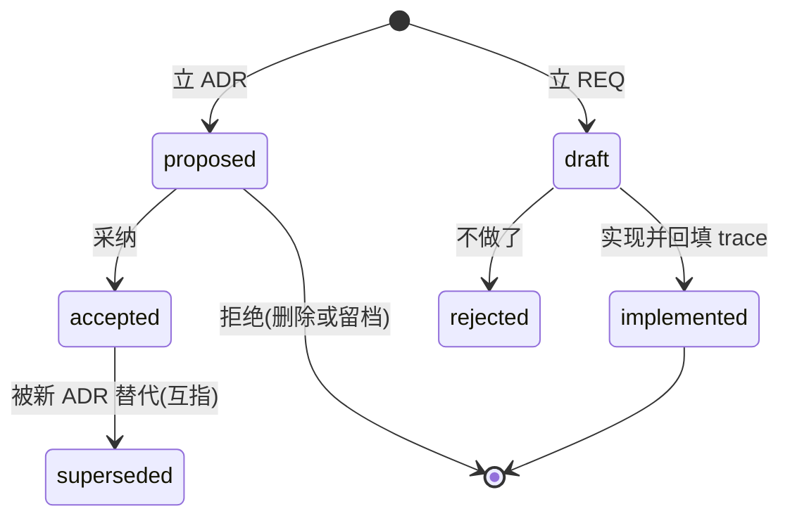

# dev-doc - dev 文档治理与静态检查

**渐进知识库型 skill**:本文件只做意图路由与形态速览;完整知识在 `references/` 分类扁平目录(前缀 base/tool/md/ls/term 分组,10 篇自包含),按「rg 定位文件 + 结构化提取」渐进检索,不要求一次读完。

核心思想:**需求决策走 ADR/REQ(动机与验收留痕),公开契约就近进代码注释,对外文档面一律是投影(单一权威源,可再生成)**。课题证据走研究档案;工程骨架走项目工具链范式;词表与规则单一权威源(termrules、mdrules),多面同源引用不复制。事实断言标六态。

## 一、意图路由（按意图直达参考）

> 表未覆盖的意图:用文件名/关键字直搜 references/,或查 `references/README.md` 索引。

| 意图 / 你要做的事 | 参考 |
| --- | --- |
| 不可逆技术选择 / 写 ADR / supersede 旧决策 | `references/base-adr.md` |
| 立需求 / REQ 状态流转 / 实现后回填 trace | `references/base-req.md` |
| 写代码 doc 注释 / 契约注释 / 文档即代码 / 投影守卫 | `references/base-code-doc.md` |
| 立研究档案 / S 编号一题一篇 / 对照分流与六态结论 | `references/base-research.md` |
| 建项目工具链 / uv 与 PEP 723 形态 / 门禁挂接与发布面 | `references/tool-project-kit.md` |
| skill/agents/claude markdown 五面静检 / 禁字 / 断链 / 行量 | `references/md-faces.md` |
| 约束术语表 / term-lint 用法 / 挖词 / PENDING 收紧 | `references/term-rules.md` |
| 新仓脚手架选类型 / 四类型模板卡 | `references/ls-types.md` |
| 结构 lint 规则件 / toml 六节表式 / 生成物与排除 | `references/ls-rules.md` |
| 结构 lint 触发场景 / 何时结构面 | `references/ls-evals.md` |
| 三层聚合与技能自进化 / 轨迹总结 / 标准 skill | 同市场技能 `evo:distil`(唯一权威源) |
| Agent 原生友好开发 / --llms 手册 / CTA 协议 | 同插件 skill `dev:dev-cli` |
| 多仓协作 / 派单回执 | `evo:agents` 与 `evo:streams`(五原语操作面) |

## 二、知识库检索（rg 定位 + 结构提取）

设计原则:目录与文件名以 **rg 检索**为先(前缀 base/tool/md/ls/term 加主题词);文档结构以**结构化提取**为先(h2 节、code 命令、表格键值)。

```bash
rg --files references | rg 关键词          # 文件名直达
rg -n "关键词" references/README.md        # 索引定位
rg -n "关键词" references/                 # 全文直搜
```

检索原则:先窄后宽(文件名到索引到正文);进文件先抽 h2 目录再定点读。

## 三、形态速览（一层概览,细节均在 references）

### ADR/REQ 状态机



编号接当前最大号;退役不复用。ADR 正文三段 Context/Decision/Consequences;REQ 正文 Scenario/Criteria;各自 README 索引表必登记。

### 代码 doc 注释与文档即代码

公开项注释即契约,改公开项同步注释与测试同提交;what 进注释,why 进 ADR。单一权威源:README、手册、--llms 面皆投影,可再生成不手改,漂移守卫进门禁,发现第二份真相即删或降指针。

### 约束术语表(单一权威,两层政策)

词表唯一权威在 `plugins/dev/scripts/termrules.py`(term-lint、check PE-13、pre-commit 三面同源引用):ENFORCED 层零基线命中强制,PENDING 层为仓内存量词(先清存量再迁入收紧);挖词走 term-mine(gw_logs 语料,方法见 `references/term-rules.md` 与研究档案 S020)。

### 门禁与挡板

三态退出码(0 过、1 业务、2 用法);pre-commit = md-guard --staged(禁字)+ term-lint --staged(术语)+ md-ref-scan 各 skill(断链);check.py PE-01 至 PE-13 走 CI 与手动道,PEVO_TERM_ALLOW 豁免 docs/ 历史档案存量(根三件永不受益)。
